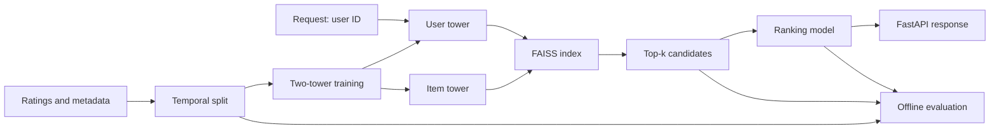

# recsys-two-tower

[](https://github.com/mohammadazam7/recsys-two-tower/actions/workflows/ci.yml)

A two-stage recommender: a two-tower model retrieves a few hundred candidates per user from
an approximate nearest neighbour index, and a ranking model orders them. Both stages are
evaluated offline on a held-out temporal split and served behind a FastAPI endpoint.

> **Status:** early development. See the [roadmap](docs/ROADMAP.md) for milestone dates.
> Results will be published here only once they have been measured, with the hardware
> they were measured on.

## Overview

Large-catalog recommenders separate recall from precision. Scoring every item for every
request is too expensive, so a cheap retrieval stage narrows the catalog and a richer
ranking stage spends its compute only on the candidates. This project implements both
stages on MovieLens and measures each one separately, so a regression can be traced to
the stage that caused it.

## Architecture



| Stage | Responsibility |
|---|---|
| Temporal split | Hold out each user's most recent interactions so evaluation never sees the future |
| Two-tower model | Learn user and item embeddings with in-batch negatives |
| ANN index | Inner-product search over item embeddings with FAISS |
| Ranking model | Rescore candidates with richer user, item and context features |
| Evaluation | Recall@k for retrieval; NDCG@k and MAP@k for the ranked list |

## Design decisions

- **Temporal, per-user holdout.** A random split leaks future behaviour into training and
  inflates offline metrics. Holding out each user's latest interactions mirrors how the
  model is used.
- **Stages evaluated separately.** Retrieval recall bounds what ranking can achieve, so
  both are reported.
- **Dataset fallback.** If MovieLens cannot be downloaded in an environment, a synthetic
  dataset with the same schema is generated and the README states which one produced each
  result.

## Getting started

```bash
python -m venv .venv && source .venv/bin/activate
make install
make check
```

## License

MIT
