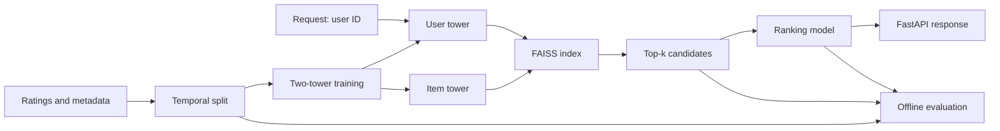

# recsys-two-tower

[](https://github.com/mohammadazam7/recsys-two-tower/actions/workflows/ci.yml)

A two-stage recommender: a two-tower model retrieves a few hundred candidates per user from
an approximate nearest neighbour index, and a ranking model orders them. Both stages are
evaluated offline on a held-out temporal split and served behind a FastAPI endpoint.

> **Status:** milestone 2 in progress. The two-tower retrieval model trains and is
> evaluated; the ANN index, ranking model and API are not built yet. See the
> [roadmap](docs/ROADMAP.md) for milestone dates.

## Overview

Large-catalog recommenders separate recall from precision. Scoring every item for every
request is too expensive, so a cheap retrieval stage narrows the catalog and a richer
ranking stage spends its compute only on the candidates. This project implements both
stages on MovieLens and measures each one separately, so a regression can be traced to
the stage that caused it.

## Architecture



| Stage | Responsibility |
|---|---|
| Temporal split | Hold out each user's most recent interactions so evaluation never sees the future |
| Two-tower model | Learn user and item embeddings with in-batch negatives |
| ANN index | Inner-product search over item embeddings with FAISS |
| Ranking model | Rescore candidates with richer user, item and context features |
| Evaluation | Recall@k for retrieval; NDCG@k and MAP@k for the ranked list |

## Results so far: retrieval on synthetic data

MovieLens could not be downloaded in the environment these were measured in, so this
table comes from the synthetic dataset in `recsys.datasets` (2000 users, 400 items,
latent-factor preferences times a Zipf-like popularity prior). It is not a MovieLens
result. Each user's most recent interaction is held out; items the user already
interacted with in training are excluded before taking the top 20.

| Configuration | recall@20 | train seconds |
|---|---|---|
| Two-tower, log-Q correction | 0.266 | 22 |
| Two-tower, no correction | 0.119 | 20 |
| Popularity | 0.234 | - |

20 epochs, batch 512, temperature 0.1, 16 dimension output, on 2 vCPUs of an Intel Xeon
at 2.10GHz with PyTorch 2.15 (CPU) and Python 3.11.

- The model beats popularity, but not by much. The generator gives each user only a
  weak personal preference on top of a strong popularity prior, so popularity is a hard
  baseline here, as it often is on real data.
- The log-Q correction matters more than any other setting I tried. In-batch negatives
  are drawn in proportion to popularity, so without the correction the loss pushes
  popular items down and the model ends up well below the popularity baseline.
- One held-out item per user means 2000 events, so a difference of 0.01 is within noise.

```bash
python examples/train_synthetic.py
```

## Design decisions

- **Temporal, per-user holdout.** A random split leaks future behaviour into training and
  inflates offline metrics. Holding out each user's latest interactions mirrors how the
  model is used.
- **Stages evaluated separately.** Retrieval recall bounds what ranking can achieve, so
  both are reported.
- **Dataset fallback.** If MovieLens cannot be downloaded in an environment, a synthetic
  dataset with the same schema is generated and the README states which one produced each
  result.

## Getting started

```bash
python -m venv .venv && source .venv/bin/activate
make install
make check
```

## License

MIT
